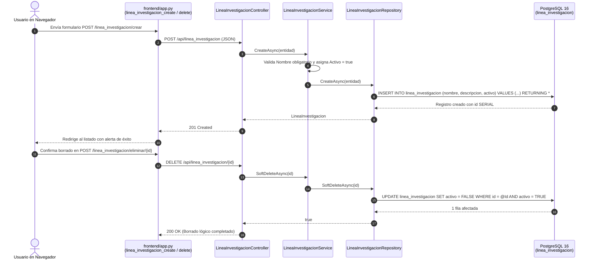
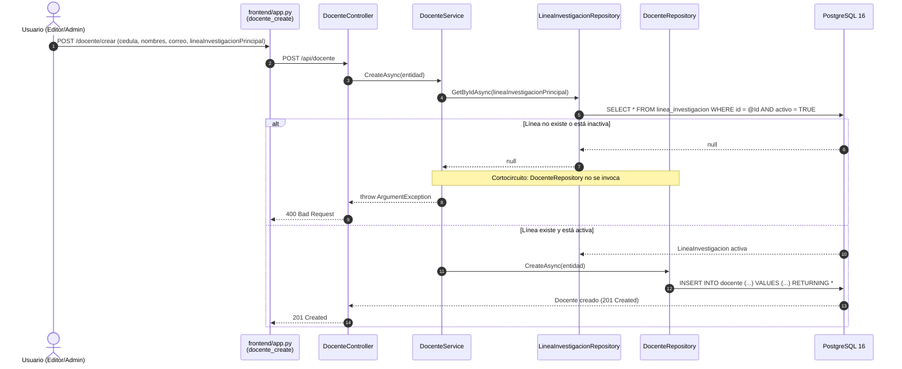
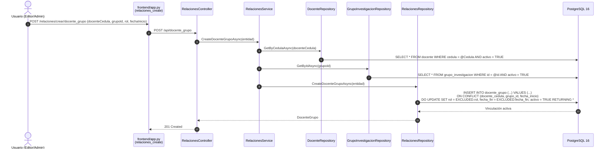
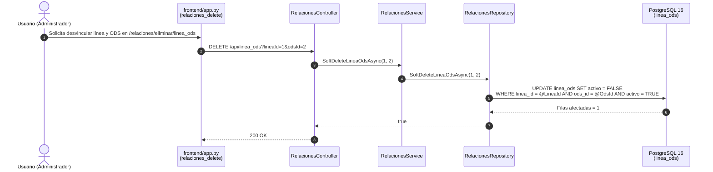
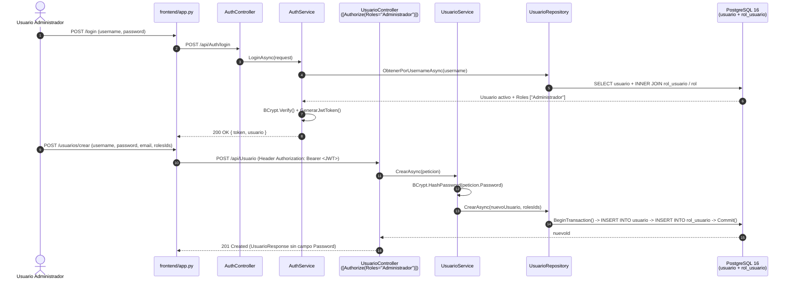
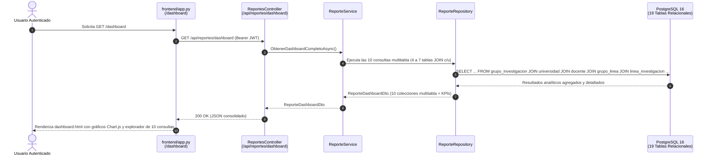

# Historias de Usuario y Diagramas de Secuencia — Proyecto MIRA (`0_historias_de_usuario.md`)

> **Par de Diseño Obligatorio (§4 de la Metodología):**  
> Cada Historia de Usuario de MIRA incluye su **Criterio de Aceptación verificable**, su **Diagrama de Secuencia en Mermaid (`sequenceDiagram`)** mostrando las clases reales del repositorio, y su **Guía de Lectura**.

---

## Evolución de Historias por Versión

| ID Historia | Versión | Título de la Historia | Entidades Involucradas |
| :---: | :---: | :--- | :--- |
| **HU 1** | `v1` | Gestión de Catálogos Científicos e Institucionales Base | `area_conocimiento`, `objetivo_desarrollo_sostenible`, `area_aplicacion`, `termino_clave`, `universidad` |
| **HU 2** | `v1` | Administración de Líneas de Investigación Institucionales | `linea_investigacion` |
| **HU 3** | `v2` | Registro y Gestión de Perfiles Docentes Investigadores | `docente`, `linea_investigacion` |
| **HU 4** | `v2` | Validación de Integridad Referencial de Claves Foráneas Activas | Todas las entidades con FK (`DocenteService`, `GrupoInvestigacionService`, `SemilleroService`, `RelacionesService`) |
| **HU 5** | `v2` | Gestión de Grupos de Investigación y Vinculación Histórica de Docentes | `grupo_investigacion`, `universidad`, `docente`, `docente_grupo` |
| **HU 6** | `v2` | Creación de Semilleros de Investigación y Asignación de Tutores por Periodo | `semillero`, `grupo_investigacion`, `docente_semillero` |
| **HU 7** | `v2` | Consultas Enriquecidas con `JOIN` para Selectores y Listados Legibles | `docente`, `grupo_investigacion`, `semillero` y las 7 tablas puente |
| **HU 8** | `v2` | Articulación de Grupos y Semilleros con Líneas de Investigación | `grupo_linea`, `semillero_linea` |
| **HU 9** | `v2` | Clasificación Temática de Líneas con Áreas OCDE, ODS y Aplicaciones | `linea_area`, `linea_ods`, `linea_area_aplicacion` |
| **HU 10** | `v3` | Autenticación Criptográfica con BCrypt y Emisión de Token JWT con Roles | `usuario`, `rol`, `rol_usuario` (`AuthController`, `AuthService`, `UsuarioRepository`) |
| **HU 11** | `v3` | Control de Acceso Basado en Roles (RBAC) y Gestión Transaccional de Usuarios | `UsuarioController`, `UsuarioService`, `UsuarioRepository` |
| **HU 12** | `v4` | Tablero Ejecutivo y 10 Consultas Analíticas Multitabla (4+ Tablas c/u) | `ReportesController`, `ReporteService`, `ReporteRepository` (19 tablas cruzadas) |

---

## Versión 1 (`v1`): Catálogos Base sin Claves Foráneas

### HU 1 y HU 2 — Gestión de Catálogos Base y Líneas de Investigación con Borrado Lógico
- **Como** coordinador de investigación,
- **Quiero** registrar, consultar, actualizar y desactivar lógicamente los catálogos base (`area_conocimiento`, `objetivo_desarrollo_sostenible`, `area_aplicacion`, `termino_clave`, `universidad` y `linea_investigacion`),
- **Para** contar con un diccionario normalizado y trazable sin perder el historial mediante eliminaciones físicas.
- **Criterios de Aceptación:**
  1. `POST /api/linea_investigacion` con `nombre` válido inserta el registro con `activo = true` y devuelve `201 Created`.
  2. `DELETE /api/linea_investigacion/{id}` ejecuta `UPDATE linea_investigacion SET activo = FALSE` y el registro deja de aparecer en `GET /api/linea_investigacion`.

> **Guía de lectura:** Las cajas representan los componentes reales de la rebanada vertical de catálogos (`app.py` → `LineaInvestigacionController` → `LineaInvestigacionService` → `LineaInvestigacionRepository` → `PostgreSQL`). Las flechas muestran cómo tanto el alta como la baja lógica pasan por todas las capas sin ejecutar jamás un `DELETE` físico.

---

## Versión 2 (`v2`): Entidades Relacionales y Tablas Puente

### HU 3, HU 4 y HU 7 — Gestión de Docentes con Validación de Clave Foránea y Consulta Enriquecida
- **Como** gestor académico,
- **Quiero** registrar docentes investigadores vinculándolos a una línea de investigación principal activa y consultar su perfil con el nombre legible de dicha línea,
- **Para** garantizar la integridad referencial antes de tocar la base de datos y evitar mostrar IDs numéricos crudos en la interfaz.
- **Criterios de Aceptación:**
  1. Si se envía una `lineaInvestigacionPrincipal` que no existe o tiene `activo = false`, `DocenteService` corta la ejecución lanzando `ArgumentException` y `DocenteController` retorna `400 Bad Request`.
  2. `GET /api/docente` ejecuta `LEFT JOIN linea_investigacion` y devuelve `lineaInvestigacionNombre`.

> **Guía de lectura:** El bloque `alt / else` ilustra cómo `DocenteService` consulta primero a `LineaInvestigacionRepository` para verificar que la clave foránea exista y esté activa antes de autorizar la escritura en `DocenteRepository`.

---

### HU 5 y HU 6 — Grupos, Semilleros y Vinculación Histórica en Tablas Puente (`docente_grupo` y `docente_semillero`)
- **Como** director de investigaciones,
- **Quiero** crear grupos y semilleros de investigación y vincularles docentes con su rol, fechas de vigencia o periodo académico,
- **Para** mantener la trazabilidad histórica de quién lideró o integró cada estructura investigativa.
- **Criterios de Aceptación:**
  1. `POST /api/grupo_investigacion` valida que `universidadId` y `docenteLiderCedula` existan y estén activos.
  2. `POST /api/docente_grupo` y `POST /api/docente_semillero` vinculan o reactivan (`ON CONFLICT DO UPDATE SET activo = TRUE`) la participación del docente validando que ambos extremos estén activos.

> **Guía de lectura:** Las flechas desde `RelacionesService` hacia `DocenteRepository` y `GrupoInvestigacionRepository` muestran la doble comprobación de integridad referencial antes de ejecutar el `UPSERT` (`ON CONFLICT DO UPDATE`) en `RelacionesRepository`.

---

### HU 8 y HU 9 — Articulación Temática de Líneas con Grupos, Semilleros, Áreas OCDE, ODS y Aplicaciones
- **Como** comité curricular y de investigación,
- **Quiero** asociar y desasociar líneas de investigación con grupos (`grupo_linea`), semilleros (`semillero_linea`), áreas OCDE (`linea_area`), ODS (`linea_ods`) y sectores de aplicación (`linea_area_aplicacion`),
- **Para** mapear el impacto científico y sostenible de la universidad.
- **Criterios de Aceptación:**
  1. `GET /api/linea_ods` retorna los nombres enriquecidos de la línea y del ODS mediante `INNER JOIN`.
  2. `DELETE /api/linea_ods?lineaId=1&odsId=2` desactiva lógicamente el vínculo compuesto (`activo = FALSE`).

> **Guía de lectura:** El diagrama muestra cómo las llaves primarias compuestas viajan por *Query Parameters* desde `app.py` hasta `RelacionesController` y ejecutan un borrado lógico parametrizado en `RelacionesRepository`.

---

## Versión 3 (`v3`): Seguridad JWT, Hashing BCrypt y Control de Roles RBAC

### HU 10 y HU 11 — Inicio de Sesión con JWT + BCrypt y Gestión de Usuarios Protegida por Rol
- **Como** administrador de seguridad del sistema MIRA,
- **Quiero** autenticar usuarios mediante contraseñas hasheadas con BCrypt, emitir tokens JWT con sus roles y restringir la creación/desactivación de usuarios exclusivamente al rol `Administrador`,
- **Para** impedir accesos no autenticados (`401 Unauthorized`) o acciones sin privilegios (`403 Forbidden`).
- **Criterios de Aceptación:**
  1. `POST /api/Auth/login` verifica el hash con `BCrypt.Net.BCrypt.Verify` y emite un JWT firmado con `HmacSha256` que incluye los claims `ClaimTypes.Role`.
  2. `POST /api/Usuario` encripta la contraseña con BCrypt e inserta el usuario y sus roles dentro de una transacción ACID (`BeginTransaction`).

> **Guía de lectura:** La primera mitad del diagrama muestra la autenticación y emisión del token JWT en `AuthService`, y la segunda mitad muestra cómo ese token autoriza el ingreso a `UsuarioController`, donde `UsuarioService` aplica el hash BCrypt y `UsuarioRepository` ejecuta la transacción ACID en PostgreSQL.

---

## Versión 4 (`v4`): Analítica Multitabla (10 Consultas de 4+ Tablas) y Dashboard Ejecutivo

### HU 12 — Ejecución de las 10 Consultas Analíticas Multitabla y Visualización en Dashboard
- **Como** directivo o analista de investigación,
- **Quiero** visualizar un tablero ejecutivo con gráficos estadísticos e inspeccionar 10 reportes analíticos que cruzan 4 o más tablas del modelo relacional,
- **Para** tomar decisiones basadas en datos sobre productividad de grupos, cobertura de ODS, áreas OCDE, semilleros y talento humano.
- **Criterios de Aceptación:**
  1. `GET /api/reportes/dashboard` y `/api/reportes/consulta-1` .. `/api/reportes/consulta-10` ejecutan consultas Dapper que unen entre 4 y 7 tablas activas mediante `INNER JOIN` / `LEFT JOIN`.
  2. La vista `/dashboard` en Flask renderiza los gráficos interactivos con Chart.js y las tablas detalladas de las 10 consultas multitabla respetando la paleta de `marca.css`.

> **Guía de lectura:** Las cajas muestran la rebanada analítica de la `v4` (`app.py` → `ReportesController` → `ReporteService` → `ReporteRepository` → `PostgreSQL`), donde el repositorio ejecuta las 10 consultas SQL multitabla con Dapper y entrega el DTO consolidado que alimenta los gráficos de Chart.js en el navegador.
