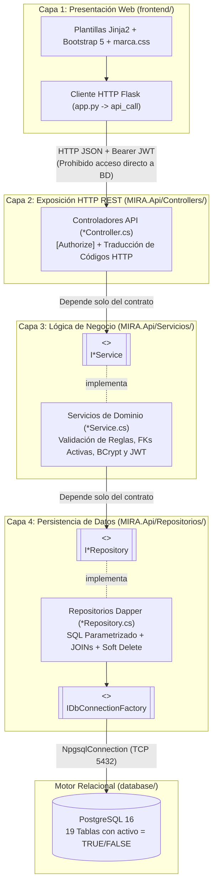

# Constitución Técnica del Proyecto MIRA (`1_constitution.md`)

> **Ley Suprema e Inmutable del Repositorio (Transversal `v1` – `v4`)**  
> Este documento define los principios permanentes de ingeniería de software, arquitectura, seguridad y gobernanza Spec-Driven Development (SDD) que rigen todas las versiones del sistema **MIRA (Módulo de Investigación para la Gestión de Proyectos Académicos)**.

---

## 1. Principios Constitucionales Innegociables

1. **Especificación antes que implementación (SDD):** Ningún componente de código se programa sin estar previamente especificado en el Spec Kit de la versión en curso.
2. **La especificación es la fuente de la verdad:** El código construido debe coincidir exactamente con los contratos, modelos y diagramas declarados en la carpeta `versiones/vN/`.
3. **Arquitectura Multicapa Estricta (`Presentación Flask` → `Controller` → `Service` → `Repository`):**
   - El **Frontend (`frontend/`)** consume exclusivamente la API REST por HTTP JSON y **jamás** se conecta de forma directa a PostgreSQL.
   - Los **Controladores (`MIRA.Api/Controllers/`)** solo gestionan el protocolo HTTP, códigos de estado y autorización por roles (`[Authorize]`), delegando toda operación a la interfaz del Servicio.
   - Los **Servicios (`MIRA.Api/Servicios/`)** concentran las validaciones de negocio e integridad referencial previa.
   - Los **Repositorios (`MIRA.Api/Repositorios/`)** son la **única capa autorizada** para abrir conexiones y ejecutar SQL en la base de datos.
4. **SQL a la Vista y Parametrizado (Dapper + Npgsql):** Se prohíbe el uso de Entity Framework Core o consultas concatenadas. Toda sentencia SQL debe usar parámetros `@Parametro` seguros contra inyección SQL.
5. **Regla Constitucional de Borrado Lógico (`Soft Delete`):** Se prohíbe el uso de `DELETE FROM` físico. Todas las tablas incluyen `activo BOOLEAN NOT NULL DEFAULT TRUE`, los endpoints `DELETE` ejecutan `UPDATE <tabla> SET activo = FALSE`, y las lecturas `GET` filtran por `WHERE activo = TRUE`.
6. **Inyección de Dependencias y Principios SOLID:** Toda comunicación entre capas se realiza a través de interfaces (`I*Service`, `I*Repository`, `IDbConnectionFactory`) registradas en el contenedor de dependencias de `Program.cs`.
7. **Cero Secretos en el Código:** Las cadenas de conexión con credenciales reales y las claves de firma JWT se inyectan mediante variables de entorno (`.env` excluido en `.gitignore`, documentado en `.env.example`).
8. **Principio YAGNI y No-Anticipación:** Cada versión implementa únicamente su alcance definido. Una versión cerrada se sella con su tag (`v1`, `v2`, `v3`, `v4`) tras pasar regresión y sus tres compuertas.

---

## 2. Diagrama Obligatorio: Regla de Dependencias entre Capas

> **Guía de lectura del diagrama:** Las cajas representan las cuatro capas físicas del sistema y los nodos con doble borde (`<<interface>>`) representan los contratos de abstracción en C#. Las flechas continuas indican las **únicas direcciones de dependencia permitidas**: el flujo viaja estrictamente de arriba hacia abajo cruzando por interfaces (`Controller` → `I*Service` → `I*Repository` → `IDbConnectionFactory` → `PostgreSQL`), impidiendo que el Frontend o los Controladores accedan directamente a la base de datos.
