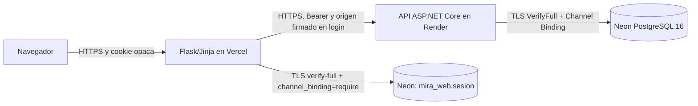

# SAPIENS — estabilización y despliegue de Fase 6

Fecha de trabajo: 12 de noviembre de 2026, America/Bogota. Nombre de producto SAPIENS; repositorio, namespaces, tablas, rutas y protocolo técnico conservan MIRA. Esta fase autoriza commits, push y despliegues no destructivos; el usuario restringió los recursos nuevos a **planes gratuitos**.

## Estado comprobado antes de publicar

Raíz `C:\Users\Usuario\OneDrive\Escritorio\MIRA`, rama `feature/mira-v3`, remoto `https://github.com/francis872/Mira.git`. HEAD inicial `3105273af84e55a1e813e76f2acb92acc31caa94`; PR #7 abierto/Draft. Respaldo completo del código candidato y configuraciones locales de raíz, SHA256 `1009d5415cb79deac5ecceaadd674001ff5c2351ed274a5c88c6b8ca36c454de`; bundle de todas las referencias Git `5222fb63a878771549c845f7a6b2209d883cc1db5c03a59b969e0360eba90120`. CRC, todos los hashes de miembros y bundle verificados. Los artefactos reproducibles de .local/build no se incluyen en ese ZIP; los respaldos anteriores siguen conservados. No se accedió a BACKSTAGE.

El cierre Fase 5 estaba implementado y probado, pero su documentación seguía incompleta. Se consolidaron sus **136 .NET, 120 Flask, 51 HTTP, 10 SQL y 51 Docker**, ejecutados el 7 de noviembre, como evidencia histórica. No se presentan como ejecución de Fase 6.

La repetición actual aprobó **138 .NET, 132 Flask, 51 HTTP y 11 suites SQL**, sin fallos ni omisiones, en PostgreSQL local exclusivo. Incluye persistencia de sesiones entre dos aplicaciones Flask independientes, rotación de identificador, vencimiento, manipulación de datos, caída de lectura/escritura y configuración TLS. D01 integrado conserva orígenes independientes, rechazo de cabeceras falsificadas y revocación tras reinicio. La verificación Docker usa PostgreSQL para sesiones; la interfaz mantiene el modo de archivos para instalaciones persistentes existentes.

OSV y NuGet se consultaron de nuevo sin avisos reportados. Esto no cubre todos los paquetes del sistema operativo ni garantiza ausencia de vulnerabilidades futuras. Responsive, axe, teclado y zoom se registran con sus resultados actuales; las revisiones asistivas humanas y dispositivos físicos siguen pendientes.

## Arquitectura preparada

Vercel ejecuta Flask como una función; no ejecuta Docker/Gunicorn ni la API .NET. El frontend usa almacenamiento PostgreSQL compartido, no disco efímero ni JWT dentro de cookies. El rol web solo accede a su tabla de sesiones; el rol API tiene DML de dominio y ejecución de rutinas, sin DDL, propiedad ni edición de `schema_migrations`. Los cambios de datos académicos se realizan mediante la API. No se migró a Next.js ni se sustituyó PostgreSQL.

La firma HMAC protege el contenido de sesión almacenado y la clave primaria es SHA256 del identificador opaco aleatorio. El contenido permanece en el servidor y requiere tratar la base y sus respaldos como sensibles. Una caída del almacén devuelve 503 sin afirmar login/logout exitoso, emitir JWT al navegador o cambiar a un almacenamiento inseguro. Se mantienen expiración absoluta, rotación, cookies Secure/HttpOnly/Strict y CSRF.

`MIRA_PLATFORM=vercel` solo admite el entorno oficial `VERCEL=1`; usa la cabecera de origen que Vercel sobrescribe en su ingreso administrado. Una cabecera ausente o inválida hace fallar el login de forma cerrada. El perfil existente de proxies con CIDR explícitos sigue disponible fuera de Vercel. [Documentación del ingreso](https://vercel.com/docs/headers/request-headers), [Flask en Vercel](https://vercel.com/docs/frameworks/backend/flask).

## Servicios y costes

- Vercel: equipo Hobby comprobado y proyecto nuevo `sapiens-v1-v3-20261112`, directorio `frontend`; todavía debe distinguirse un proyecto creado de un despliegue funcional.
- Neon: organización con plan **free** comprobado; proyecto nuevo `snowy-bonus-50718377`, nombre `sapiens-v1-v3-fase6-20261112`, PostgreSQL 16.16, región aws-us-east-1, base `sapiens`. No se modificaron bases existentes.
- Render: workspace autorizado; servicio API nuevo previsto exclusivamente con `plan=free`, sin disco ni réplicas de pago y con autodespliegue desactivado.

No se contrataron planes de pago. Los planes gratuitos tienen cuotas y límites: Render los describe como apropiados para demostraciones y pruebas, no como garantía de producción. [Límites oficiales](https://render.com/docs/free). No se eleva un plan para superar un bloqueo sin autorización.

## Variables y secretos

| Componente | Variables |
|---|---|
| API | ASPNETCORE_ENVIRONMENT=Production, PORT, ConnectionStrings__PostgreSql, Jwt__Key/Issuer/Audience/Minutes, LoginProtection__ForwardingKey |
| Web | MIRA_ENV=production, MIRA_PLATFORM=vercel, MIRA_SESSION_BACKEND=postgres, MIRA_SESSION_DATABASE_URL, API_URL HTTPS, SECRET_KEY, MIRA_LOGIN_FORWARDING_KEY, SESSION_COOKIE_SECURE=true |

Las claves CI/dev/Preview/Production se generan separadas; forwarding es independiente de JWT y SECRET_KEY. Se suministran mediante los gestores oficiales y se conservan solo en archivos privados ignorados cuando la automatización local lo requiere. Nunca se incluyen valores, conexiones completas, tokens ni dumps en Git o evidencias públicas. `.vercel`, `.env*` privadas y el OIDC creado por la CLI permanecen excluidos.

## Migraciones y recuperación

Se aplicaron **001–015** al proyecto Neon nuevo después de verificar identidad, esquema vacío, certificado TLS y Channel Binding. Se generó un `pg_dump -Fc`, se restauró en otra base local vacía y se comprobó el resultado antes del DDL remoto. La aplicación completa de migraciones al esquema vacío fue una transacción. Se probaron roles runtime con intentos de DDL/lectura cruzada denegados. El enlace cliente–proxy Neon usa TLS: `pg_stat_ssl` refleja el enlace interno del proveedor y no demuestra por sí solo el TLS del cliente.

009 rechaza datos V1 incompatibles antes de cambiarlos. 010 preserva datos V2 incompletos mediante CHECK NOT VALID; completar códigos, traducciones y descripciones aprobados antes de validar las restricciones en una actualización con datos existentes. 012 no inventa disciplinas/ODS heredados. 014 completa el catálogo plural de 17 ODS. 015 crea un esquema independiente para sesiones web sin cambiar FK académicas ni autenticación JWT. Migraciones 001–008 intactas.

Para recuperar: registrar SHA/digests y configuración privada aprobados; restaurar un backup en un destino nuevo; validar migraciones, roles, login y revocación; cambiar únicamente los servicios de este proyecto al destino comprobado. No ejecutar down migrations ni restaurar encima de datos reales. Volver solo a una versión V3 segura y compatible; la versión basada únicamente en archivos no sirve como rollback de Vercel. No regresar a acceso público V2.

## Operación y aceptación pendiente

`/health` mide liveness. `/ready` de API comprueba conexión/esquema con plazo de cinco segundos; `/ready` web comprueba almacenamiento de sesión y API. Ambos ocultan información de conexión. Los logs usan correlación generada por el servidor y evitan cuerpos, cookies, consultas y credenciales. La comprobación TCP de PostgreSQL evita que Compose confunda su servidor temporal de inicialización con el definitivo.

Mantener separados tres dictámenes: operación técnica del entorno desplegado, aceptación académica de los criterios originales y validación de producción. C06, Facultad, periodo activo/líder y vínculo cuenta–docente siguen pendientes de definición; no hay excepciones académicas aceptadas. El código funcional de estos dominios no se inventó para facilitar la publicación.

Las URL, commits, Actions y pruebas remotas se registrarán únicamente después de obtener resultados reales. Un proyecto creado, un build o un `/health` 200 no equivalen a una plataforma desplegada y validada.
