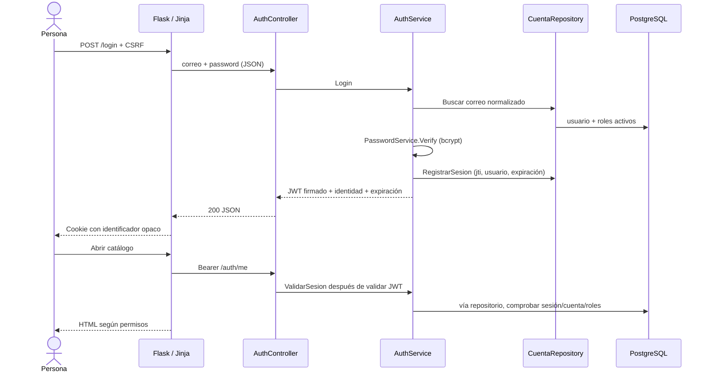

# Arquitectura MIRA V3

## Componentes y responsabilidades

Se conserva ASP.NET Core net10.0, Flask/Jinja y PostgreSQL 16. No se reemplazan catálogos ni el modelo oficial V2. No se introduce React.

Los controladores reciben contratos y devuelven estados HTTP. Los servicios autentican, validan y coordinan. Solo repositorios importan Dapper/Npgsql. `CuentaRepository` usa los procedimientos de 003 para crear/bootstrap/inactivar y los de 008 para cambiar roles/contraseña con revocación atómica. Los repositorios de V1/V2 conservan sus rutinas originales.

## Decisiones de seguridad

- `PasswordService.Hash`: bcrypt coste 12 con sal automática. Mínimo 12 caracteres y hasta 72 bytes UTF-8. `Verify` nunca compara hashes generados nuevamente; usa BCrypt.Verify. Hashes heredados desconocidos o texto plano se rechazan. El administrador puede restablecerlos desde Cuentas sin recuperar contraseñas anteriores.
- `AuthService.GenerarJwt`: HS256, `sub/email/role/iat/exp/iss/aud/jti`; duración predeterminada 20 minutos. `JwtSettings.Validation` exige firma, algoritmo, emisor, audiencia y expiración, sin tolerancia temporal. Clave externa de 32 bytes mínimo; no hay clave de producción por defecto.
- `sesion_acceso` registra cada jti. `OnTokenValidated` consulta la sesión y la cuenta en cada petición: cierre de sesión elimina jti; inactivación bloquea acceso; cambio de correo/roles o contraseña elimina sesiones. Las consultas en curso pueden terminar antes de una revocación concurrente. No se promete cancelar operaciones ya iniciadas.
- `SeguridadConfiguration.AddSeguridad` aplica la política `Datos` a todos los controladores. No hay autorización basada solo en HTML. `/health` y POST login son públicos; el resto exige autenticación. Swagger solo en Development, con Bearer.
- Límite login: 10 intentos/minuto por dirección remota, por instancia API; 429. No confiar en X-Forwarded-For sin configurar un proxy conocido. Un despliegue con varias réplicas necesitará límites compartidos en su gateway.
- Cuenta inactiva, usuario ausente y contraseña incorrecta reciben 401 uniforme. Los logs registran tipo de fallo y referencia, sin contraseña, hash ni JWT.
- Recuperación de un administrador activo heredado con hash desconocido: `--reset-admin-password` invoca `AuthService.RestablecerAdmin`, solo por CLI con acceso operativo a PostgreSQL; guarda bcrypt y revoca sesiones. `bootstrap-admin.ps1 -ResetPassword` facilita este flujo. No existe una ruta pública de recuperación ni se permite restablecer cuentas ajenas desde el login.

## Identidades heredadas

`usuario`, `rol`, `usuario_rol` (003) son cuentas de acceso. `usuarios`, `roles`, `usuario_roles` (006) son el modelo académico oficial; `docentes.usuario_id` depende de él. No se sincronizan ni se equiparan por ID. Crear una cuenta no crea automáticamente un docente o persona. Una futura unificación requeriría una migración explícita y aprobación de datos.

## Matriz de permisos

| Rol | GET catálogos/investigación | POST/PUT | DELETE | Administración de cuentas |
|---|---|---|---|---|
| Investigador | Sí | No | No | No |
| Coordinador | Sí | Sí | No | No |
| Administrador | Sí | Sí | Sí | Sí |

Cada usuario puede consultar su identidad y cerrar su sesión. Los permisos son globales; V2 no contiene propiedad de registros que permita limitar por autor. El guardado de una ficha grupo-semilleros es una modificación atómica completa, con las mismas reglas de V2.

## Sesiones Flask y cliente HTTP

`app.py::api_call` es el único cliente HTTP, también inyectado al blueprint de investigación. Añade Bearer desde la sesión del servidor, nunca desde un formulario. `seguridad.configure_session` utiliza Flask-Session/CacheLib en `.local/sessions` o `SESSION_DIRECTORY`. El identificador de cookie se regenera después del login y CSRF se renueva. El JWT no aparece en HTML ni localStorage. `protect_routes` comprueba expiración absoluta, revalida `/auth/me` y controla las rutas de escritura. El cierre local funciona incluso si falla la API; se advierte cuando no se pudo confirmar la revocación.

La cookie usa HttpOnly y SameSite Strict; Secure debe ser true con HTTPS. `MIRA_ENV=production` exige SECRET_KEY externa >=32 caracteres, Secure, API_URL HTTPS y SESSION_DIRECTORY absoluta. Todo POST, incluidos login/logout, exige CSRF. `Cache-Control: no-store`, `nosniff`, `DENY` contra marcos y Referrer-Policy reducen exposición del HTML privado. No hay refresh token; después de 20 minutos se inicia sesión de nuevo.

El almacenamiento CacheLib en archivos está destinado a una instancia local con directorio privado y confiable. No compartirlo con usuarios del sistema no autorizados: usa serialización propia de CacheLib. Producción distribuida requiere almacenamiento de sesiones compartido (p. ej. Redis), HTTPS en ambos saltos y secretos administrados; no se configura infraestructura ni se incurre en costes en esta entrega.

## Interfaz e iconos

`mira.css` conserva el diseño adaptable existente y lo evoluciona a negro, blanco y grafito; mantiene avisos semánticos. `base.html` incorpora identidad, rol y salida; `login.html` tiene una portada institucional adaptable. Formularios y tablas originales se conservan.

React Icons necesita React. En Jinja se usa un sprite SVG local de Tabler Icons 3.34.1 y una macro compartida `includes/icons.html::icon`; licencia MIT en `static/icons/LICENSE`. No se descarga tipografía de iconos por CDN. Bootstrap CSS/JS conserva sus CDN existentes: se necesita acceso a ellos para esos estilos y comportamiento móvil. No se declara certificación WCAG completa; se verifican componentes y limitaciones en V3_PRUEBAS.

Referencias de implementación: [JWT en ASP.NET Core](https://learn.microsoft.com/en-us/aspnet/core/security/authentication/configure-jwt-bearer-authentication), [rotación Flask-Session](https://flask-session.readthedocs.io/en/latest/security.html), [Tabler 3.34.1](https://github.com/tabler/tabler-icons/tree/v3.34.1).

## Perfil de estabilización

Gunicorn Linux (un worker/cuatro threads) y volumen privado de sesiones para una instancia. Ambas imágenes ejecutan sin root. PORT se comprueba en modo Production local; DbConnectionFactory exige VerifyFull/Channel Binding Require y errores SQL detallados desactivados. El ejemplo Render es revisable y pasó JSON Schema; no se aplicó. Reinicio de Gunicorn conservando sesión y revocación JWT se verificaron sobre Docker local HTTP. HTTPS real, Neon y redeploy del disco siguen pendientes: ver V3_REVISION_FINAL y deploy/README.
