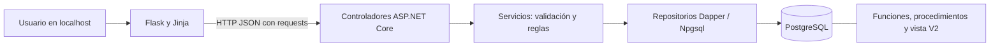
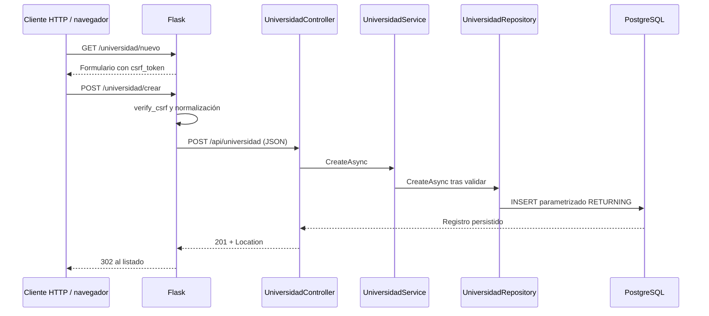

# Arquitectura real de MIRA

## Componentes

`frontend/app.py` contiene rutas y el cliente HTTP `api_call`. Las plantillas de `frontend/templates/` generan formularios y listados. La cookie firmada transporta token CSRF y mensajes, sin identidad de usuario. Bootstrap e iconos se descargan desde jsDelivr; su apariencia y modales dependen de ese recurso externo.

`MIRA.Api/Program.cs` registra seis servicios y seis repositorios con DI. Los controladores de `MIRA.Api/Peticiones/` traducen HTTP y errores esperados. `Servicios/` valida campos obligatorios, normaliza textos y verifica existencia. Los atributos `StringLength` de `Modelos/` hacen cumplir los límites de la migración 001 antes del acceso a datos. Solo `Repositorios/` usa la fábrica `Configuracion/DbConnectionFactory.cs` para ejecutar SQL parametrizado.

## Flujo concreto: crear universidad

Un dato inválido produce 400 y vuelve al formulario con sus valores. Un duplicado de término produce 409. Un fallo de conexión o JSON incompatible produce información no disponible; no se inventa un conteo. Los listados filtran `activo = TRUE`; DELETE actualiza el indicador a falso, no elimina la fila.

## Persistencia y migraciones

La migración 001 crea seis tablas independientes, sin FK entre ellas. La 002 carga semillas. La 003 crea `usuario`, `rol`, `usuario_rol`, `vw_usuarios_roles`, funciones JSONB y procedimientos `sp_usuario_*`. Estas rutinas no tienen rutas HTTP ni pantallas activas.

`database/migrations/apply.sh` y `scripts/start-local.ps1` registran migraciones en `schema_migrations`; cada archivo y su registro se ejecutan en una transacción. Las operaciones maestro-detalle existentes se realizan en PostgreSQL mediante una rutina; el fallo de una operación no deja un maestro parcialmente escrito. No se han definido entidades académicas V2 adicionales porque falta el modelo oficial.

## Ejecución

Windows local: PostgreSQL 17.9 dedicado bajo `.local/postgres`, API .NET 10 y Flask en procesos ocultos, escuchando en loopback. Docker declara PostgreSQL 16, .NET 10 y Python 3.11; esa combinación no se ejecutó en esta auditoría. No se debe equiparar el resultado de PostgreSQL 17 local con una prueba de PostgreSQL 16.

Configuración y secretos provienen de `.env.local` o `.env`, ignorados por Git. PID y logs locales viven en `.local/`. `/health` es una comprobación de vida de la API: no consulta la base. El arranque local comprueba además `/api/universidad` y el dashboard.

## Decisiones registradas

| ID | Decisión y razón |
|---|---|
| ADR-MIRA-01 | Adaptar el prompt a MIRA, confirmado por el usuario; no introducir módulos de Backstage inexistentes. |
| ADR-MIRA-02 | Conservar Flask + .NET + PostgreSQL y sus capas, porque los seis flujos ya funcionan. |
| ADR-MIRA-03 | Mantener V1/V2 sin autenticación según alcance vigente; no usar las tablas de usuarios para crear pantallas adicionales. |
| ADR-MIRA-04 | Capturar la restricción UNIQUE en el repositorio de términos; la consulta previa del servicio no evita carreras ni detecta inactivos. |
| ADR-MIRA-05 | Usar validación de longitud de modelos con el contrato de error estándar ASP.NET; no alterar las columnas ni truncar datos. |
| ADR-MIRA-06 | Separar base de pruebas y base operativa; conservar la base de auditoría para inspección. Las E2E usan registros identificados e inactivados en la plataforma local. |
| ADR-MIRA-07 | Limitar publicaciones Docker a loopback por el alcance local sin control de acceso. Producción requiere una evaluación independiente. |
