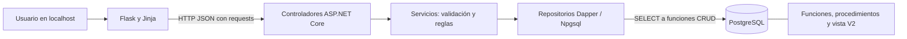
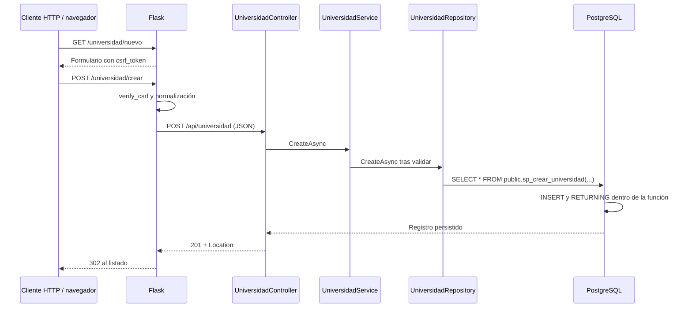

# Arquitectura real de MIRA

## Componentes

`frontend/app.py` contiene rutas y el cliente HTTP `api_call`. Las plantillas de `frontend/templates/` generan formularios y listados. La cookie firmada transporta token CSRF y mensajes, sin identidad de usuario. Bootstrap e iconos se descargan desde jsDelivr; su apariencia y modales dependen de ese recurso externo.

`MIRA.Api/Program.cs` registra seis servicios y seis repositorios V1 y las capas de investigación con DI. Los controladores de `MIRA.Api/Peticiones/` traducen HTTP y errores esperados. `Servicios/` valida campos obligatorios y verifica existencia; normaliza textos salvo el nombre de área de aplicación, delegado al trigger. Los atributos `StringLength` de `Modelos/` hacen cumplir los límites de la migración 001 antes del acceso a datos. Solo `Repositorios/` usa la fábrica `Configuracion/DbConnectionFactory.cs`, y únicamente invoca funciones parametrizadas: no contiene CRUD directo sobre tablas.

## Flujo concreto: crear universidad

Un dato inválido produce 400 y vuelve al formulario con sus valores. Un duplicado de término produce 409. Un fallo de conexión o JSON incompatible produce información no disponible; no se inventa un conteo. Los listados filtran `activo = TRUE`; DELETE actualiza el indicador a falso, no elimina la fila.

## Persistencia y migraciones

La migración 001 crea seis tablas independientes, sin FK entre ellas. La 002 carga semillas. La 003 crea `usuario`, `rol`, `usuario_rol`, `vw_usuarios_roles`, funciones JSONB y procedimientos `sp_usuario_*`. Estas rutinas no tienen rutas HTTP ni pantallas activas.

La 004 define 30 funciones SQL: cinco por catálogo, todas con prefijo `sp_` por la convención solicitada. Son FUNCTION invocadas por SELECT; no se usa `CommandType.StoredProcedure`/CALL para ellas. Listar y consultar devuelven SETOF de la tabla; crear devuelve la fila persistida; actualizar y eliminar devuelven boolean. La excepción legada 003 conserva sus procedimientos CALL para evitar incompatibilidades.

La 005 añade `tr_area_aplicacion_normalizar`, BEFORE INSERT/UPDATE OF nombre, que llama a `fn_area_aplicacion_normalizar`. No añade columnas ni toca retroactivamente filas. La API y Flask envían el nombre original; el trigger recorta espacios extremos, rechaza vacío y la función de alta devuelve el valor final. La prueba SQL desactiva el trigger dentro de una transacción de pruebas para demostrar que esa transformación ocurre en el trigger y revierte los cambios al terminar.

`ApiExceptionMiddleware` traduce errores de integridad y devuelve un JSON seguro; los errores automáticos de contrato se presentan en español. El registro se dirige a consola, capturada en `.local`, y no depende de permisos de Windows Event Log. Los mensajes brutos de excepciones no se registran desde ese middleware.

`database/migrations/apply.sh` y `scripts/start-local.ps1` registran migraciones en `schema_migrations`; cada archivo y su registro se ejecutan en una transacción. Las operaciones maestro-detalle existentes se realizan en PostgreSQL mediante una rutina; el fallo de una operación no deja un maestro parcialmente escrito. El usuario confirmó los SQL de `880ac75` como oficiales. La 006 incorpora sus 19 tablas sin reemplazar V1; 007 añade 78 funciones y once vistas. `InvestigacionController` → `InvestigacionService` → `Repositorios/Investigacion/InvestigacionRepository` atiende once recursos y cinco puentes. Los metadatos cerrados de `RecursosInvestigacion.cs` definen campos/tipos y evitan nombres SQL arbitrarios. `frontend/investigacion.py` aporta los formularios y selectores.

## Ejecución

Windows local: PostgreSQL 17.9 dedicado bajo `.local/postgres`, API .NET 10 y Flask en procesos ocultos, escuchando en loopback. Docker declara PostgreSQL 16, .NET 10 y Python 3.11; esa combinación no se ejecutó en esta auditoría. No se debe equiparar el resultado de PostgreSQL 17 local con una prueba de PostgreSQL 16.

Posteriormente se ejecutó PostgreSQL 16.15 con API/Flask de pruebas propios mediante `scripts/verify-postgres16.ps1`, en `.local/pg16-validation/` y puertos 5547/8082/5001. La plataforma habitual no se convirtió ni se detuvo. La suite completa pasó también en 16; esta comprobación independiente no equivale a probar Docker o Python 3.11. [Evidencia](verificacion-postgres16.md).

Configuración y secretos provienen de `.env.local` o `.env`, ignorados por Git. PID y logs locales viven en `.local/`. `/health` es una comprobación de vida de la API: no consulta la base. El arranque local comprueba además `/api/universidad` y el dashboard.

## Decisiones registradas

| ID | Decisión y razón |
|---|---|
| ADR-MIRA-01 | Adaptar el prompt a MIRA, confirmado por el usuario; no introducir módulos de Backstage inexistentes. |
| ADR-MIRA-02 | Conservar Flask + .NET + PostgreSQL y sus capas, porque los seis flujos ya funcionan. |
| ADR-MIRA-03 | Mantener V1/V2 sin autenticación según alcance vigente; no usar las tablas de usuarios para crear pantallas adicionales. |
| ADR-MIRA-04 | Capturar la restricción UNIQUE en el repositorio de términos; la consulta previa del servicio no evita carreras ni detecta inactivos. |
| ADR-MIRA-05 | Usar validación de longitud de modelos con el contrato de error estándar ASP.NET; no alterar las columnas ni truncar datos. |
| ADR-MIRA-06 | Separar base de pruebas y base operativa; conservar la base de auditoría para inspección. Las E2E usan registros identificados e inactivados en la plataforma local. |
| ADR-MIRA-07 | Limitar publicaciones Docker a loopback por el alcance local sin control de acceso. Producción requiere una evaluación independiente. |
| ADR-MIRA-08 | El prompt definitivo exige rutinas para todo CRUD: 30 funciones en 004 sustituyen SQL directo de Repository, conservando interfaces C# y HTTP. |
| ADR-MIRA-09 | Mover la normalización existente de área al trigger 005 permite demostrar un cambio real producido por PostgreSQL sin columnas artificiales. |
| ADR-MIRA-10 | Mantener siete archivos del kit V2 existente; no inventar los nombres de nueve documentos oficiales que aún no se aportaron. Añadir evidencia y reglas como documentación complementaria. |

## Ficha de grupo y semilleros

`grupo.html` e `investigacion.js` muestran todos los renglones. `group_form` envía un único JSON a `CrearFicha`/`ActualizarFicha`; Service valida y Repository invoca `sp_guardar_v2_ficha_grupo`. PostgreSQL bloquea el maestro, crea/actualiza detalles y retira los omitidos; un error revierte el comando completo. No se realizan escrituras HTTP por renglón. `sp_consultar_v2_ficha_grupo` entrega el documento compuesto para reabrirlo.

Los catálogos plurales oficiales conservan sus identificadores propios. `usuarios` tiene únicamente un endpoint de referencias con id y nombre; sin login ni CRUD. Los recursos con estado se retiran lógicamente; docentes/tutores no tienen estado y siguen la eliminación física/CASCADE oficial. El trigger de grupo activo conserva sus eventos originales, y su SQLSTATE se traduce a 409.
