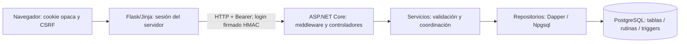

# SAPIENS — arquitectura académica V1–V3

Base tecnológica y evolución académica: **MIRA V1–V3**. Corte: 7 de noviembre de 2026, America/Bogota. Una aplicación evolutiva; las versiones no son tres instalaciones independientes. Namespaces, endpoints, tablas y emisor/audiencia siguen siendo MIRA. [Informe e índice](14_informe_cierre.md).

| Responsabilidad | Archivo y símbolo comprobados |
|---|---|
| Composición, middleware y DI | `MIRA.Api/Program.cs`; registra servicios/repositorios, seguridad, controladores y health |
| HTTP V1 | Seis `MIRA.Api/Peticiones/*Controller.cs`: GetAll, GetById (GetByTermino en términos), Create, Update, Delete |
| HTTP V2 | `InvestigacionController`: Listar, Obtener, ObtenerPuente, Crear, Actualizar, Eliminar, RetirarPuente, Ficha, CrearFicha, ActualizarFicha |
| HTTP V3 | `AuthController`: Login, Me, Logout, Usuarios, Roles, Crear, Editar, Inactivar, Restablecer |
| Negocio | Servicios V1; `InvestigacionService.Validar/GuardarFicha`; `AuthService` y `PasswordService` |
| Datos | Repositorios V1, `InvestigacionRepository` y `CuentaRepository`; `DbConnectionFactory.CreateConnection` |
| Modelos y contratos | `MIRA.Api/Modelos`: clases V1, Seguridad.cs con requests/respuestas, RecursosInvestigacion.cs con lista cerrada de campos |
| Presentación | `frontend/app.py`, investigacion.py, seguridad.py, login_protection.py; Jinja y recursos estáticos |

Se verificó separación HTTP→servicio→repositorio, SQL parametrizado y DI. Los catálogos y seguridad usan interfaces; `InvestigacionService` recibe un repositorio concreto. Los servicios de seguridad agrupan varias responsabilidades. Esto fundamenta separación de responsabilidades y algunas prácticas SOLID; **no certifica cumplimiento absoluto de SOLID**. No se ejecuta SQL desde Flask ni desde controladores.

V1 tiene seis catálogos singulares independientes. V2 añade el modelo académico plural confirmado y sus relaciones, sin reemplazarlos. V3 protege ambos con identidad y permisos globales. El antiguo acceso público fue sustituido por una instrucción explícita de V3; no se registra como regresión accidental. `/health` permanece público.

La transacción académica principal es grupo→semilleros: una función JSONB de PostgreSQL guarda maestro y colección, retira detalles omitidos y revierte cambios si falla un detalle. No existe una ficha universidad→grupo o línea→docente. La transacción de cuentas→roles es distinta.

Flask mantiene el JWT en CacheLib del servidor; el navegador conserva solo el identificador de sesión. Las cuentas de acceso `usuario` no son las personas académicas `usuarios`. No se inventó correspondencia entre sus IDs. Las tres capas no equivalen a tres microservicios.

Las pruebas actuales demuestran los flujos implementados. Los requisitos históricos omitidos se exponen en la matriz y no se consideran satisfechos por esta arquitectura. No hay módulo de proyectos, entregas, reportes consolidados o exportaciones.
