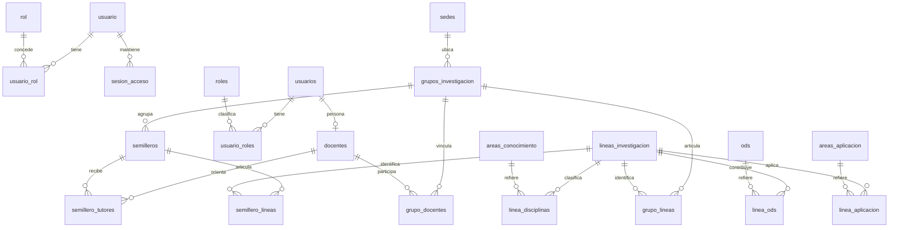

# Extensión aditiva Fase 5

Migraciones 001–008 y fuentes SQL originales intactas. `010` añade `sedes.codigo_institucional text` y `palabras_clave.termino_ingles varchar(150)` por HU04-CA01/HU02-CA03. Tres CHECK NOT VALID exigen código, inglés y descripción de línea en nuevas escrituras, preservando filas heredadas incompletas. No se crean Facultad, periodos ni vínculo cuenta–docente sin definición.

`009` exige inglés V1 no vacío y categorías exactas; aborta antes de cambiar filas incompatibles y admite únicamente normalizar el rótulo heredado Económico→Económica. `012` añade mínimos de disciplina/ODS en guardado atómico y triggers diferibles; los arrays de vista no son columnas de tabla. `014` completa los 17 ODS plurales con nombres PNUD sin reasignar IDs ni modificar el catálogo singular. Los 22 campos FK públicos siguen NOT NULL; C06 pendiente.

[Actualización/restauración comprobada](evidencias/fase5-20261107/upgrade-recuperacion.json). Los datos históricos faltantes se completan con valores aprobados antes de validar restricciones; no se inventan traducciones, códigos ni relaciones.

---

## Corte previo conservado como antecedente

# Modelo de datos contrastado con PostgreSQL

[Metadatos reales](evidencias/esquema.json) · [consulta reproducible](evidencias/consulta-esquema.sql). Instancia exclusiva PostgreSQL 16.15 reconstruida con 001–008. 30 tablas con PK (29 de aplicación + schema_migrations), 12 vistas, 30 PK, 11 restricciones UNIQUE, 8 CHECK, 22 FK, 54 índices, 116 funciones, 6 procedimientos y 2 triggers de usuario. Los 191 registros de columnas del JSON incluyen tablas y vistas; no son 191 columnas solo de tablas.

Las seis tablas V1 son singulares y sin FK. El modelo académico de 006 tiene 19 tablas plurales, incluidas sus propias personas/roles. `usuario`, `rol`, `usuario_rol` son identidad V3 y `sesion_acceso` sus jti persistentes. Ninguna FK pública es nullable. No hay vínculo implícito usuario→usuarios ni universidad→sede/grupo.

El diagrama resume la estructura y no promete reglas temporales o mínimos que no existen. Docente tiene usuario_id único, URL/categoría/escalafón opcionales. Grupo exige sede y GrupLAC. Sede no tiene código institucional. Línea plural exige código único y nombre, permite descripción NULL. Los puentes tienen PK compuesta. Participaciones tienen fecha inicial requerida y final opcional; CHECK final>inicial.

El índice parcial de líder cubre solo rol Líder de Grupo, activo y fecha_fin NULL. No exige que exista un líder ni excluye todos los periodos solapados fechados. El índice de tutor impide duplicar exactamente semillero/persona/rol/inicio/fin, normalizando NULL a una fecha centinela; no es una restricción EXCLUDE de rangos temporales.

Los catálogos con activo/activa, grupos y líneas se retiran lógicamente. Docentes y tutores no tienen estado: DELETE es físico, con cascadas donde las define 006. Los puentes se retiran físicamente. El historial no es inmutable ante todas las operaciones administrativas; la UI advierte la eliminación de docentes y sus participaciones.

Los nombres de todas las restricciones/índices/rutinas y su definición exacta están en el JSON, sin extraer registros de usuarios ni hashes. Las suites prueban PK/FK, unicidad, CHECK, trigger y rollback; no son prueba individual de cada combinación de todas las restricciones.

C06 necesita decisión docente. No se alteraron restricciones para simular opcionalidad. Migraciones futuras deberán ser nuevas, con respaldo, registro y pruebas; no se editan 001–008 ya aplicadas.
