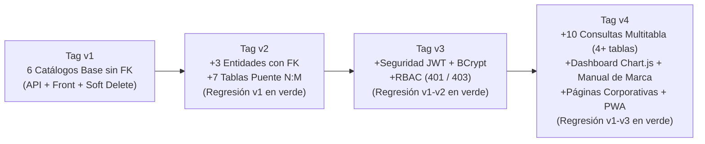

# Mapa de Versiones del Proyecto MIRA (`0_mapa_versiones.md`)

> **Gobernanza SDD por Versiones Acumulativas**  
> Registra la evolución incremental del proyecto **MIRA** desde la `v1` hasta la `v4`, sus carpetas de especificación, sus etiquetas de cierre en Git y el estado de sus compuertas de validación.

---

## Tabla General de Versiones

| Versión | Carpeta Spec Kit | Qué agrega (Acumulativo) | Compuertas (1, 2 y 3) | Tag Git | Estado |
| :---: | :--- | :--- | :---: | :---: | :---: |
| **v1** | [`versiones/v0.1_api_inicial/`](v0.1_api_inicial/2_spec.md) | CRUD completo de las **6 tablas catálogo sin claves foráneas** (`area_conocimiento`, `objetivo_desarrollo_sostenible`, `area_aplicacion`, `termino_clave`, `universidad`, `linea_investigacion`) con borrado lógico — API REST .NET 7 + Dapper + Frontend Flask. | ✅ En verde (`9_checklist.md`) | `v1` | **Cerrada y Verificada** |
| **v2** | [`versiones/v0.2_relaciones/`](v0.2_relaciones/2_spec.md) | Regresión `v1` + CRUD de las **3 entidades fuertes con FK** (`docente`, `grupo_investigacion`, `semillero`) con listas desplegables dinámicas desde la API + **7 tablas puente N:M** con reactivación `ON CONFLICT DO UPDATE` (**HU 2 a HU 9**). | ✅ En verde (`9_checklist.md`) | `v2` | **Cerrada y Verificada** |
| **v3** | [`versiones/v0.3_seguridad/`](v0.3_seguridad/2_spec.md) | Regresión `v1–v2` + **Autenticación JWT Bearer + Hashing BCrypt + Control de Acceso Basado en Roles (RBAC)** (`Administrador`, `Editor`, `Consultor`) + CRUD transaccional de `usuario`, `rol` y `rol_usuario` exclusivo para administradores. | ✅ En verde (`9_checklist.md`) | `v3` | **Cerrada y Verificada** |
| **v4** | [`versiones/v0.4_dashboard/`](v0.4_dashboard/2_spec.md) | Regresión total `v1–v3` + **10 consultas analíticas multitabla (4+ tablas c/u)** en la API + **Dashboard interactivo con gráficos Chart.js** + **Manual de Marca (`MANUAL_DE_MARCA.md`) y `marca.css`** + **5 Páginas Corporativas** + **PWA / Responsive**. | ✅ En verde (`9_checklist.md`) | `v4` | **Cerrada y Verificada** |

---

## Flujo de Evolución y Regresión Acumulativa

> **Guía de lectura del diagrama:** Cada caja representa un hito versionado sobre la rama principal y cada flecha indica la progresión acumulativa donde la versión siguiente hereda y mantiene en verde todos los criterios de aceptación de las versiones anteriores.
