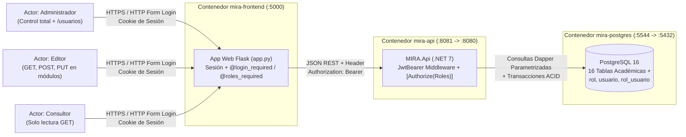

# Versión 3: Módulo de Seguridad, Autenticación, JWT y control de Roles

> **Versión 3: Módulo de Seguridad, Autenticación, JWT y control de Roles**  
> Rige la constitución permanente del proyecto: `docs/1_constitution.md`.  
> En esta versión el sistema incorpora el módulo transversal de seguridad con almacenamiento de contraseñas mediante hashing BCrypt, emisión y validación de tokens JWT (JSON Web Token) y Control de Acceso Basado en Roles (RBAC) tanto en la API REST (.NET 7) como en la interfaz web en Flask.

---

## 1. Propósito

Dotar al sistema **MIRA (Módulo de Investigación para la Gestión de Proyectos Académicos)** de la Universidad de San Buenaventura Medellín de una capa de seguridad robusta que proteja los recursos académicos e investigativos mediante autenticación basada en tokens firmados (`JWT Bearer`) y autorización diferenciada por roles (`Administrador`, `Editor` y `Consultor`).

---

## 2. Diagrama Obligatorio: Contexto del Sistema (v0.3)

> **Guía de lectura del diagrama:** Las cajas externas representan los tres perfiles de usuario que interactúan con el contenedor `mira-frontend`. Las flechas muestran qué viaja entre cada frontera: credenciales de formulario hacia Flask, peticiones HTTP con el encabezado `Authorization: Bearer <JWT>` hacia `mira-api`, y consultas SQL parametrizadas con Dapper hacia `mira-postgres`.

---

## 3. Alcance

### 3.1. Capacidades de Seguridad Cubiertas
* **Autenticación Segura con BCrypt y JWT:** Validación de credenciales institucionales en `POST /api/Auth/login`, comparación criptográfica del hash `BCrypt` y generación de un token JWT firmado con `HmacSha256` que incluye los claims de identidad y roles del usuario.
* **Gestión de Usuarios y Roles (RBAC):** Administración de cuentas de usuario (`GET`, `POST`, `DELETE` lógico en `/api/Usuario`) restringida exclusivamente al rol `Administrador`, con asignación transaccional de roles en base de datos.
* **Protección de Endpoints por Rol:** Aplicación declarativa de `[Authorize]` y `[Authorize(Roles = "...")]` en todos los controladores de la API REST y decoradores `@login_required` / `@roles_required` en el Frontend Flask.

### 3.2. Entidades de Seguridad Incluidas
1. `rol` (`id` [PK SERIAL], `nombre` [UNIQUE], `descripcion`, `activo`, `fecha_creacion`).
2. `usuario` (`id` [PK SERIAL], `username` [UNIQUE], `password` [Hash BCrypt], `email` [UNIQUE], `nombre_completo`, `activo`, `fecha_creacion`, `fecha_actualizacion`).
3. `rol_usuario` (`usuario_id` [FK], `rol_id` [FK], `activo`, `fecha_asignacion`) — Tabla puente con PK compuesta `(usuario_id, rol_id)`.

### 3.3. Matriz de Control de Acceso Basado en Roles (RBAC)
1. **`Consultor`:** Acceso de solo lectura (`GET`) a los catálogos y módulos académicos.
2. **`Editor`:** Acceso de lectura (`GET`), creación (`POST`) y edición (`PUT`) en los módulos académicos y articulaciones.
3. **`Administrador`:** Control total del sistema, incluyendo borrado lógico (`DELETE`) en todos los módulos y administración exclusiva del módulo de usuarios (`/api/Usuario` y `/usuarios`).

---

## 4. Requisitos Funcionales y No Funcionales

* **RF1 — Autenticación y Emisión de Token JWT (`POST /api/Auth/login`):** Valida `username` activo y hash con `BCrypt.Net.BCrypt.Verify`. Responde `401 Unauthorized` si falla o `200 OK` con `{ token, usuario }`.
* **RF2 — Encriptación de Contraseñas y Registro Transaccional (`POST /api/Usuario`):** Aplica `BCrypt.Net.BCrypt.HashPassword` e inserta en `usuario` y `rol_usuario` bajo una transacción `BeginTransaction()`.
* **RF3 — Autorización por Roles (`401` vs `403`) y Borrado Lógico (`DELETE /api/Usuario/{id}`):** Usuarios sin token reciben `401 Unauthorized`; usuarios con token válido pero sin el rol exigido reciben `403 Forbidden`.
* **RNF1 — Separación de DTOs de Seguridad:** Las respuestas `UsuarioResponse` y `LoginResponse` jamás exponen el campo `Password`.

---

## 5. Compuerta 1: Clarificaciones Resueltas

1. **¿Dónde se almacena el JWT en el Frontend Flask?** Se almacena en la sesión firmada del servidor Flask (`session["jwt_token"]`) y se inyecta automáticamente en el encabezado `Authorization: Bearer <token>` dentro de `api_call()`.
2. **¿Qué ocurre si un usuario es desactivado (`activo = FALSE`)?** No puede volver a autenticarse en `/api/Auth/login` (`WHERE username = @Username AND activo = TRUE`) y desaparece del listado de usuarios activos.

---

## 6. Criterios de Aceptación (Rúbrica de la Versión 3)

1. **Rechazo de Peticiones No Autenticadas:** Cualquier solicitud a un controlador protegido sin token JWT válido recibe `401 Unauthorized`.
2. **Restricción Efectiva por Rol:** Un usuario con rol `Consultor` o `Editor` que intente eliminar un registro (`DELETE`) o acceder a `/api/Usuario` recibe `403 Forbidden`.
3. **Hashing BCrypt Verificado:** Las contraseñas en la tabla `usuario` se almacenan exclusivamente como hashes `$2a$11$...` generados con BCrypt.
4. **Flujo Completo en Frontend y Swagger:** Es posible iniciar sesión con el usuario administrador inicial (`admin`), navegar según los permisos del rol asignado y cerrar sesión limpiamente.
