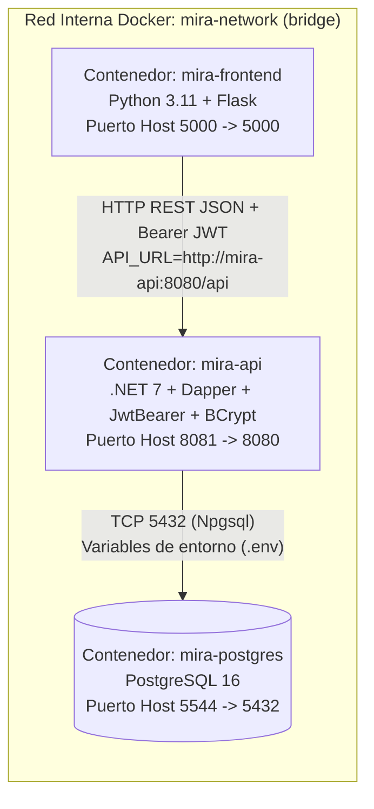
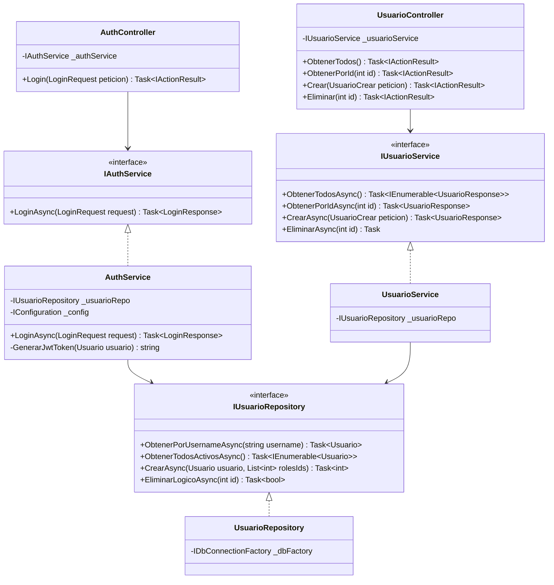
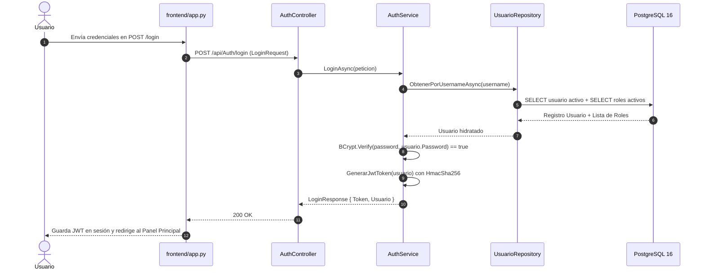

# Plan Técnico de Implementación — MIRA v0.3 (`3_plan.md`)

> **Versión 0.3:** Seguridad Perimetral Stateless con JWT Bearer, Hashing BCrypt y Control de Acceso Basado en Roles (RBAC).

---

## 1. Diagrama Obligatorio 1: Arquitectura de Despliegue (Docker Compose)

> **Guía de lectura:** Las tres cajas representan los contenedores orquestados por `docker-compose.yml` dentro de la red `mira-network`, indicando el mapeo de puertos hacia la máquina anfitriona (`5000`, `8081` y `5544`) y el protocolo que conecta cada servicio.

---

## 2. Diagrama Obligatorio 2: Diagrama de Clases de la Rebanada de Seguridad

> **Guía de lectura:** El diagrama de clases muestra las clases reales de C# en `MIRA.Api` para autenticación y usuarios, donde los controladores dependen únicamente de las interfaces `IAuthService` e `IUsuarioService`, y los servicios dependen de `IUsuarioRepository`.

---

## 3. Diagrama Obligatorio 3: Secuencia del Camino Feliz (Login y Emisión de JWT)

> **Guía de lectura:** Representa el camino feliz de inicio de sesión desde el formulario en Flask hasta la verificación del hash BCrypt y la firma del token JWT en `AuthService`.

---

## 4. Compuerta 2: Chequeo de Constitución

- [x] **Regla de Capas (`Controller` → `Service` → `Repository`):** `AuthController` y `UsuarioController` no contienen lógica criptográfica ni consultas SQL.
- [x] **SQL Parametrizado con Dapper:** `UsuarioRepository` utiliza parámetros `@Username`, `@Email`, `@UsuarioId`, `@RolId` y transacciones explícitas `BeginTransaction()`.
- [x] **Borrado Lógico:** `EliminarLogicoAsync` ejecuta `UPDATE usuario SET activo = FALSE, fecha_actualizacion = CURRENT_TIMESTAMP`.
- [x] **Cero Secretos Quemados:** La clave de firma JWT y la cadena de conexión se inyectan por variables de entorno desde `.env` / `docker-compose.yml`.
