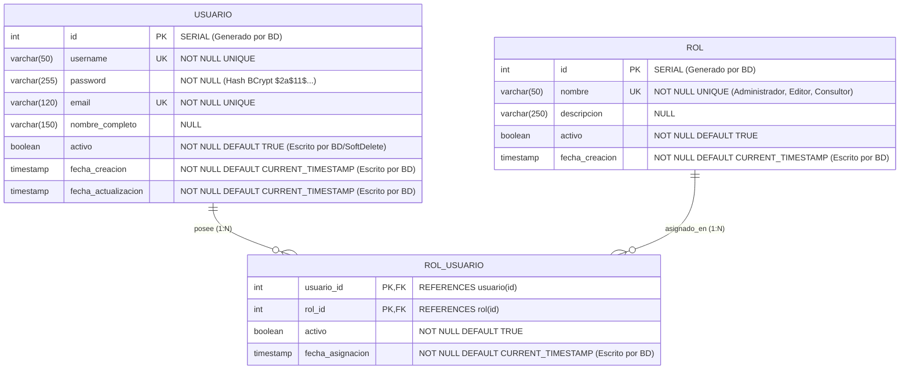

# Modelo de Datos de Seguridad — MIRA v0.3 (`5_data_model.md`)

> **Esquema Relacional del Subsistema de Seguridad RBAC (`database/init/04_seguridad_v0.3.sql`)**

---

## 1. Diagrama Obligatorio: Entidad-Relación de Seguridad (`erDiagram`)

> **Guía de lectura del diagrama:** Las tres cajas representan las tablas físicas de seguridad en PostgreSQL (`usuario`, `rol` y la tabla puente `rol_usuario`), indicando sus llaves primarias (`PK`), foráneas (`FK`), restricciones únicas (`UK`) y qué columnas de auditoría (`id`, `activo`, `fecha_creacion`) son gestionadas directamente por el motor de base de datos.

---

## 2. Diccionario de Datos (Delta v0.3)

### 2.1. Tabla `rol`
Almacena los tres perfiles de autorización del sistema (`1: Administrador`, `2: Editor`, `3: Consultor`).

### 2.2. Tabla `usuario`
Almacena las credenciales institucionales con contraseña encriptada mediante BCrypt y soporte de borrado lógico (`activo = TRUE/FALSE`).

### 2.3. Tabla Puente `rol_usuario`
Relación muchos a muchos con clave primaria compuesta `(usuario_id, rol_id)` que vincula a cada usuario con sus roles activos.
