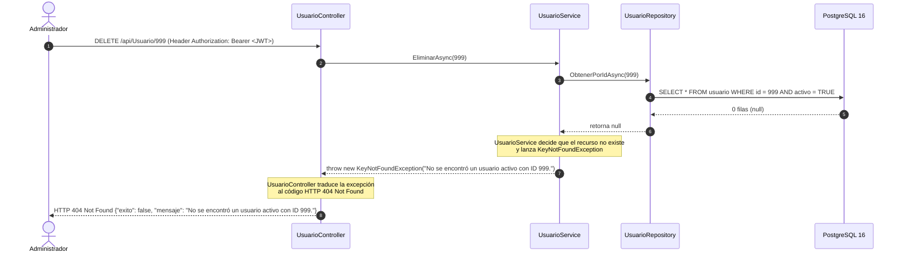
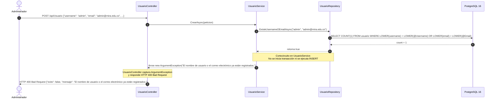

# Contratos de la API REST — MIRA v0.3 (`6_contracts.md`)

> **Especificación de Endpoints de Autenticación (`/api/Auth`) y Administración de Usuarios (`/api/Usuario`)**

---

## 1. Endpoints del Subsistema de Seguridad (v0.3)

| Método | Ruta | Autorización Requerida | Cuerpo de Entrada (DTO) | Respuestas HTTP |
| :---: | :--- | :--- | :--- | :--- |
| `POST` | `/api/Auth/login` | `[AllowAnonymous]` | `LoginRequest { username, password }` | `200 OK` (`LoginResponse`) \| `401 Unauthorized` |
| `GET` | `/api/Usuario` | `[Authorize(Roles = "Administrador")]` | *Ninguno* | `200 OK` \| `401 Unauthorized` \| `403 Forbidden` |
| `GET` | `/api/Usuario/{id}` | `[Authorize(Roles = "Administrador")]` | *Ninguno* | `200 OK` \| `404 Not Found` |
| `POST` | `/api/Usuario` | `[Authorize(Roles = "Administrador")]` | `UsuarioCrear { username, password, email, nombreCompleto, rolesIds }` | `201 Created` \| `400 Bad Request` |
| `DELETE` | `/api/Usuario/{id}` | `[Authorize(Roles = "Administrador")]` | *Ninguno* | `200 OK` (Borrado lógico) \| `404 Not Found` |

---

## 2. Diagramas Obligatorios: Secuencias de Error (`404 Not Found` y `400 Bad Request`)

### 2.1. Secuencia de Error `404 Not Found` (Quién decide "no existe")

> **Guía de lectura:** El diagrama muestra cómo `UsuarioRepository` devuelve `null` al consultar un ID inexistente o inactivo, `UsuarioService` lanza `KeyNotFoundException` y `UsuarioController` la traduce a `404 Not Found`.

---

### 2.2. Secuencia de Error `400 Bad Request` (Dónde corta la validación de duplicados)

> **Guía de lectura:** El diagrama ilustra el cortocircuito en `UsuarioService` cuando `ExisteUsernameOEmailAsync` detecta un usuario o correo duplicado, evitando abrir la transacción de escritura y devolviendo `400 Bad Request`.
