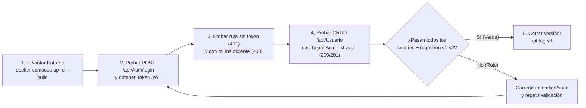

# Guía de Inicio Rápido y Validación — MIRA v0.3 (`7_quickstart.md`)

> **Comandos de Verificación de Autenticación JWT y Control de Roles RBAC**

---

## 1. Diagrama Obligatorio: Ciclo de Validación de la Versión 3



> **Guía de lectura:** El diagrama de flujo muestra la secuencia de pasos para arrancar los contenedores, ejecutar las pruebas de humo de seguridad (`200`, `401`, `403`) y decidir el cierre con `tag v3`.

---

## 2. Comandos de Prueba Rápida (`curl`)

### 2.1. Iniciar sesión y obtener Token JWT (`200 OK`)
```bash
curl -X POST http://localhost:8081/api/Auth/login \
  -H "Content-Type: application/json" \
  -d "{\"username\": \"<USUARIO_ADMIN>\", \"password\": \"<PASSWORD_ADMIN>\"}"
```

### 2.2. Verificar bloqueo `401 Unauthorized` sin Token
```bash
curl -i http://localhost:8081/api/docente
```

### 2.3. Consultar listado de usuarios con Token de Administrador (`200 OK`)
```bash
curl -H "Authorization: Bearer <TOKEN_JWT>" http://localhost:8081/api/Usuario
```
