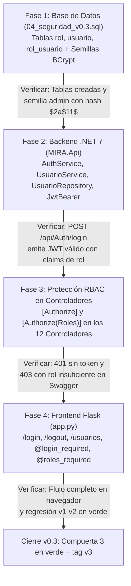

# Plan de Tareas y Orden de Fases — MIRA v0.3 (`8_tasks.md`)

> **Desglose de Tareas de Implementación y Verificación de la Entrega 3**

---

## 1. Diagrama Obligatorio: Orden de Fases con Compuertas de Verificación

> **Guía de lectura:** Cada caja representa una fase de construcción de la `v0.3` y la etiqueta de cada flecha (`Verificar: ...`) define la condición obligatoria que debe cumplirse antes de avanzar a la siguiente fase.

---

## 2. Lista de Tareas Completadas (v0.3)

- [x] **T1.1:** Crear `database/init/04_seguridad_v0.3.sql` con las tablas `rol`, `usuario` y `rol_usuario` y semillas con hash BCrypt.
- [x] **T2.1:** Agregar paquetes `BCrypt.Net-Next` y `Microsoft.AspNetCore.Authentication.JwtBearer` en `MIRA.Api.csproj`.
- [x] **T2.2:** Crear modelos `Usuario.cs`, `Rol.cs` y DTOs `LoginRequest.cs`, `LoginResponse.cs`, `UsuarioCrear.cs`, `UsuarioResponse.cs`.
- [x] **T2.3:** Implementar `IUsuarioRepository` y `UsuarioRepository` con transacciones `BeginTransaction()` en Dapper.
- [x] **T2.4:** Implementar `IAuthService`, `AuthService`, `IUsuarioService` y `UsuarioService`.
- [x] **T2.5:** Implementar `AuthController` y `UsuarioController` y configurar JWT + Swagger Bearer en `Program.cs`.
- [x] **T3.1:** Proteger los 10 controladores académicos con `[Authorize]`, `[Authorize(Roles = "Administrador,Editor")]` y `[Authorize(Roles = "Administrador")]`.
- [x] **T4.1:** Implementar `/login`, `/logout`, `/usuarios`, `api_call()` con inyección Bearer JWT y decoradores RBAC en `frontend/app.py`.
