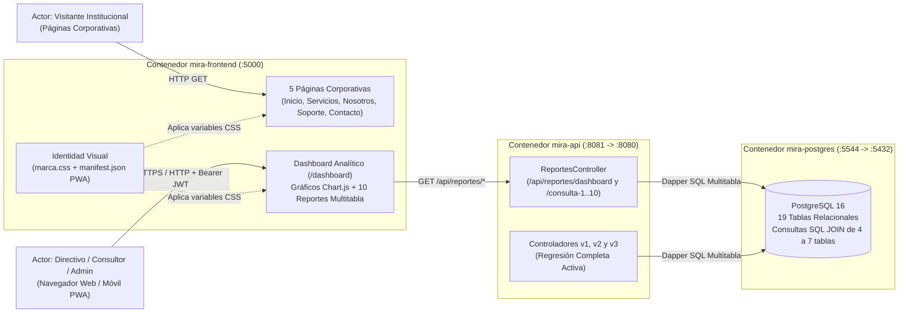

# Especificación de Requisitos — MIRA v0.4 (Cierre del Aplicativo, Analítica Multitabla y Marca)

> **Versión 4 (Cierre del Proyecto):** 10 Consultas Analíticas Multitabla (4+ tablas c/u), Dashboard Ejecutivo con Gráficos Interactivos, Manual de Marca (`MANUAL_DE_MARCA.md` + `marca.css`), Páginas Corporativas y Soporte Responsive/PWA.  
> Rige la constitución permanente del proyecto: `docs/1_constitution.md`.

---

## 1. Propósito

Culminar el desarrollo del sistema **MIRA** transformando los datos transaccionales y relacionales de las versiones `v1`, `v2` y `v3` en **inteligencia institucional para la toma de decisiones**, acompañada de una identidad corporativa formalizada en un Manual de Marca, cinco páginas corporativas y soporte de aplicación web progresiva (PWA).

---

## 2. Diagrama Obligatorio: Contexto del Sistema (v0.4)

> **Guía de lectura del diagrama:** Muestra cómo la `v0.4` incorpora el módulo analítico (`ReportesController` y `/dashboard` con Chart.js), las 5 páginas corporativas públicas y la capa transversal de identidad visual (`marca.css` y PWA), manteniendo intacta toda la funcionalidad de las versiones `v1` a `v3`.

---

## 3. Alcance de la Versión 4

### 3.1. Las 10 Consultas Multitabla (Mínimo 4 Tablas por Consulta)
Cada una de las 10 consultas une mediante `INNER JOIN` / `LEFT JOIN` entre **4 y 7 tablas** del modelo relacional:
1. **Consulta 1 (5 tablas):** Productividad de Grupos por Universidad, Ciudad, Docente Líder y Líneas (`grupo_investigacion` + `universidad` + `docente` + `grupo_linea` + `linea_investigacion`).
2. **Consulta 2 (5 tablas):** Ecosistema de Semilleros, Grupos, Universidades y Tutores por Periodo (`semillero` + `grupo_investigacion` + `universidad` + `docente_semillero` + `docente`).
3. **Consulta 3 (6 tablas):** Impacto en ODS por Línea, Grupo y Universidad (`objetivo_desarrollo_sostenible` + `linea_ods` + `linea_investigacion` + `grupo_linea` + `grupo_investigacion` + `universidad`).
4. **Consulta 4 (6 tablas):** Cobertura de Áreas OCDE por Línea, Grupo y Docente Líder (`area_conocimiento` + `linea_area` + `linea_investigacion` + `grupo_linea` + `grupo_investigacion` + `docente`).
5. **Consulta 5 (6 tablas):** Transferencia Tecnológica por Área de Aplicación, Línea, Semillero y Grupo (`area_aplicacion` + `linea_area_aplicacion` + `linea_investigacion` + `semillero_linea` + `semillero` + `grupo_investigacion`).
6. **Consulta 6 (5 tablas):** Trayectoria Histórica de Docentes en Grupos, Universidades y Líneas Matrices (`docente` + `linea_investigacion` + `docente_grupo` + `grupo_investigacion` + `universidad`).
7. **Consulta 7 (7 tablas):** Articulación Temática de Semilleros con Líneas, Áreas OCDE y ODS (`semillero` + `semillero_linea` + `linea_investigacion` + `linea_area` + `area_conocimiento` + `linea_ods` + `objetivo_desarrollo_sostenible`).
8. **Consulta 8 (5 tablas):** Capacidad Investigativa por Ciudad y Universidad (`universidad` + `grupo_investigacion` + `docente` + `semillero` + `docente_grupo`).
9. **Consulta 9 (6 tablas):** Mapa Integral 360° de Líneas de Investigación (`linea_investigacion` + `grupo_linea` + `semillero_linea` + `linea_ods` + `linea_area` + `linea_area_aplicacion`).
10. **Consulta 10 (4 tablas):** Auditoría de Seguridad RBAC, Usuarios, Roles y Directorio Docente (`usuario` + `rol_usuario` + `rol` + `docente`).

### 3.2. Dashboard Ejecutivo con Gráficos (`Chart.js`)
Vista interactiva en `/dashboard` con 4 gráficos dinámicos (barras, dona, polar/radar y barras horizontales) más un explorador tabular con pestañas para inspeccionar en vivo las 10 consultas multitabla.

### 3.3. Manual de Marca, `marca.css`, Páginas Corporativas y PWA
- Manual de Marca en `MANUAL_DE_MARCA.md` y variables centralizadas en `frontend/static/css/marca.css`.
- 5 Páginas Corporativas: **Inicio Corporativo (`/corporativo/inicio`)**, **Productos y Servicios (`/corporativo/servicios`)**, **Sobre Nosotros (`/corporativo/nosotros`)**, **Soporte (`/corporativo/soporte`)** y **Contacto (`/corporativo/contacto`)**.
- Manifiesto Web App (`manifest.json`) y Service Worker (`sw.js`) para soporte Responsive/PWA.

---

## 4. Compuerta 1: Clarificaciones Resueltas

1. **¿Qué roles pueden consultar el Dashboard y las 10 consultas multitabla?** Cualquier usuario autenticado (`Administrador`, `Editor` o `Consultor`), dado que son operaciones de lectura analítica (`GET`) protegidas con `[Authorize]`.
2. **¿Las páginas corporativas requieren iniciar sesión?** No; las 5 páginas corporativas son públicas para presentar la identidad de la plataforma MIRA a visitantes e instituciones aliadas, mientras que el acceso a los módulos operativos y al dashboard requiere sesión JWT activa.
