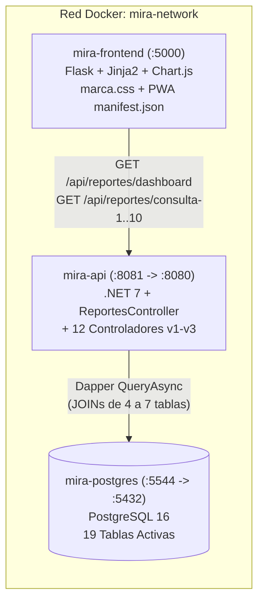
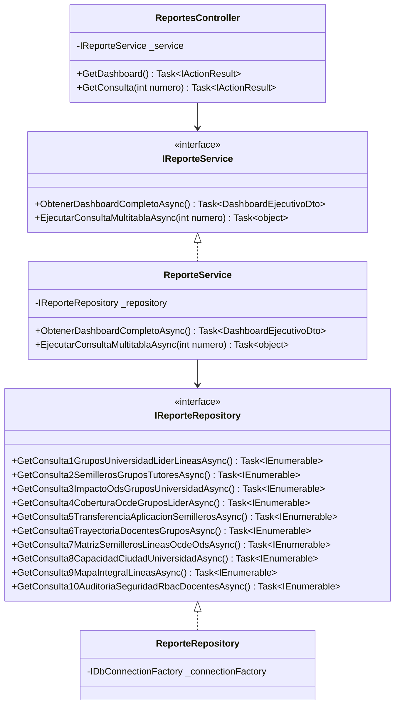
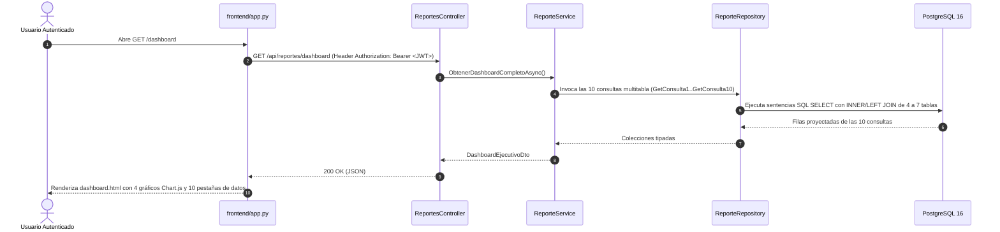

# Plan Técnico de Implementación — MIRA v0.4 (`3_plan.md`)

> **Versión 0.4:** Consultas Analíticas Multitabla en Dapper, Dashboard con Chart.js, Identidad Corporativa y PWA.

---

## 1. Diagrama Obligatorio 1: Despliegue de Contenedores y Servicios (v0.4)

> **Guía de lectura:** Ilustra la topología de contenedores en la `v0.4`, donde `mira-frontend` incorpora Chart.js, `marca.css` y soporte PWA, consumiendo los nuevos endpoints analíticos de `mira-api`.

---

## 2. Diagrama Obligatorio 2: Diagrama de Clases del Módulo de Reportes Multitabla

> **Guía de lectura:** Muestra la arquitectura de clases de la rebanada analítica (`ReportesController` → `IReporteService` → `IReporteRepository`), manteniendo el desacoplamiento por interfaces exigido en la constitución.

---

## 3. Diagrama Obligatorio 3: Secuencia del Camino Feliz (Dashboard y 10 Consultas)

> **Guía de lectura:** Describe cómo una petición a `/dashboard` viaja autenticada con JWT hasta `ReporteRepository`, hidrata las 10 consultas multitabla desde PostgreSQL y alimenta los gráficos de Chart.js en el cliente.

---

## 4. Compuerta 2: Chequeo de Constitución

- [x] **Respeto de las 4 capas:** `ReportesController` delega en `IReporteService` y este en `IReporteRepository`.
- [x] **SQL Explícito con Dapper:** Las 10 consultas multitabla están escritas en SQL puro con `INNER JOIN` y `LEFT JOIN`, filtrando registros activos (`activo = TRUE`).
- [x] **Identidad Visual Desacoplada:** Los estilos de `/dashboard` y de las 5 páginas corporativas consumen las variables de `frontend/static/css/marca.css` definidas en `MANUAL_DE_MARCA.md`.
