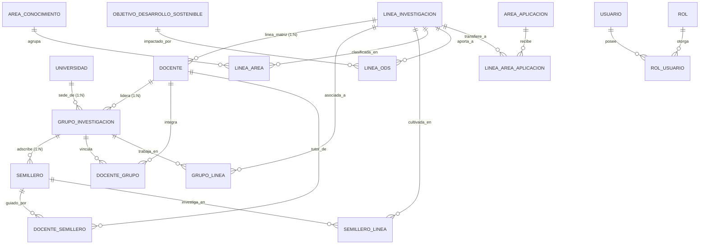

# Modelo de Datos Analítico Completo — MIRA v0.4 (`5_data_model.md`)

> **Mapa Entidad-Relación de las 19 Tablas Cruzadas en las 10 Consultas Multitabla**

---

## 1. Diagrama Obligatorio: Entidad-Relación Global (`erDiagram`)

> **Guía de lectura del diagrama:** El diagrama Entidad-Relación consolida las 19 tablas del proyecto (6 catálogos `v1`, 3 entidades fuertes `v2`, 7 tablas puente `v2` y 3 tablas de seguridad `v3`), mostrando las rutas de navegación relacional que recorren las 10 consultas multitabla de la `v0.4`.

---

## 2. Matriz de Tablas Unidas por cada Consulta Multitabla (v0.4)

| Consulta | Cantidad de Tablas | Tablas Unidas mediante `JOIN` |
| :---: | :---: | :--- |
| **Consulta 1** | **5 tablas** | `grupo_investigacion`, `universidad`, `docente`, `grupo_linea`, `linea_investigacion` |
| **Consulta 2** | **5 tablas** | `semillero`, `grupo_investigacion`, `universidad`, `docente_semillero`, `docente` |
| **Consulta 3** | **6 tablas** | `objetivo_desarrollo_sostenible`, `linea_ods`, `linea_investigacion`, `grupo_linea`, `grupo_investigacion`, `universidad` |
| **Consulta 4** | **6 tablas** | `area_conocimiento`, `linea_area`, `linea_investigacion`, `grupo_linea`, `grupo_investigacion`, `docente` |
| **Consulta 5** | **6 tablas** | `area_aplicacion`, `linea_area_aplicacion`, `linea_investigacion`, `semillero_linea`, `semillero`, `grupo_investigacion` |
| **Consulta 6** | **5 tablas** | `docente`, `linea_investigacion`, `docente_grupo`, `grupo_investigacion`, `universidad` |
| **Consulta 7** | **7 tablas** | `semillero`, `semillero_linea`, `linea_investigacion`, `linea_area`, `area_conocimiento`, `linea_ods`, `objetivo_desarrollo_sostenible` |
| **Consulta 8** | **5 tablas** | `universidad`, `grupo_investigacion`, `docente`, `semillero`, `docente_grupo` |
| **Consulta 9** | **6 tablas** | `linea_investigacion`, `grupo_linea`, `semillero_linea`, `linea_ods`, `linea_area`, `linea_area_aplicacion` |
| **Consulta 10** | **4 tablas** | `usuario`, `rol_usuario`, `rol`, `docente` |
