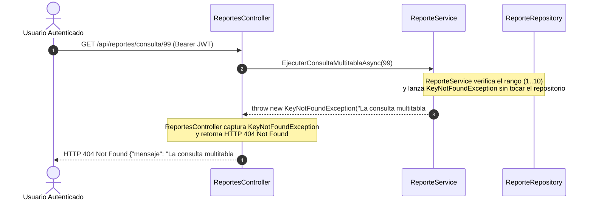
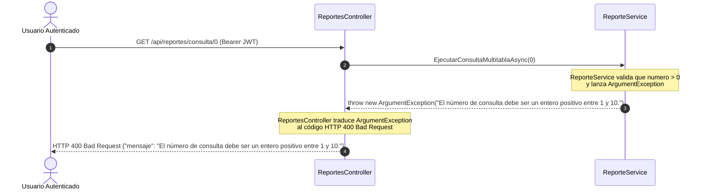

# Contratos de la API REST — MIRA v0.4 (`6_contracts.md`)

> **Especificación de los Endpoints Analíticos Multitabla (`/api/reportes`)**

---

## 1. Catálogo de Endpoints Analíticos (v0.4)

Todos los endpoints del controlador `ReportesController` requieren autenticación JWT (`[Authorize]`):

| Método | Ruta | Tablas Unidas (`JOIN`) | Descripción del Reporte Analítico | Respuestas HTTP |
| :---: | :--- | :---: | :--- | :--- |
| `GET` | `/api/reportes/dashboard` | **19 tablas** | Retorna el payload consolidado (`DashboardEjecutivoDto`) con las 10 consultas multitabla y agregaciones para los gráficos. | `200 OK` \| `401 Unauthorized` |
| `GET` | `/api/reportes/consulta/1` | **5 tablas** | Productividad de grupos por universidad, ciudad, docente líder y líneas de investigación. | `200 OK` |
| `GET` | `/api/reportes/consulta/2` | **5 tablas** | Ecosistema de semilleros, grupo matriz, universidad sede y tutores por periodo. | `200 OK` |
| `GET` | `/api/reportes/consulta/3` | **6 tablas** | Impacto en Objetivos de Desarrollo Sostenible (ODS) por línea, grupo y universidad. | `200 OK` |
| `GET` | `/api/reportes/consulta/4` | **6 tablas** | Cobertura de Áreas de Conocimiento OCDE por línea, grupo y docente líder. | `200 OK` |
| `GET` | `/api/reportes/consulta/5` | **6 tablas** | Transferencia tecnológica por área de aplicación, línea, semillero y grupo. | `200 OK` |
| `GET` | `/api/reportes/consulta/6` | **5 tablas** | Trayectoria histórica de docentes en grupos, universidades y líneas matrices. | `200 OK` |
| `GET` | `/api/reportes/consulta/7` | **7 tablas** | Matriz de pertinencia temática de semilleros con líneas, áreas OCDE y ODS. | `200 OK` |
| `GET` | `/api/reportes/consulta/8` | **5 tablas** | Capacidad investigativa agregada por ciudad, universidad, grupos, semilleros y docentes. | `200 OK` |
| `GET` | `/api/reportes/consulta/9` | **6 tablas** | Mapa integral 360° de líneas de investigación (grupos, semilleros, áreas, ODS y aplicaciones). | `200 OK` |
| `GET` | `/api/reportes/consulta/10` | **4 tablas** | Auditoría de seguridad RBAC (usuarios, asignaciones `rol_usuario`, roles y cruce con `docente`). | `200 OK` |

---

## 2. Diagramas Obligatorios: Secuencias de Error (`404 Not Found` y `400 Bad Request`)

### 2.1. Secuencia de Error `404 Not Found` (Consulta Analítica No Existente)

> **Guía de lectura:** Muestra cómo `ReporteService` valida el identificador de consulta (`1..10`) y lanza `KeyNotFoundException`, la cual es traducida por `ReportesController` a `404 Not Found`.

---

### 2.2. Secuencia de Error `400 Bad Request` (Identificador Inválido `<= 0`)

> **Guía de lectura:** Muestra el corte de validación en `ReporteService` ante un número de consulta fuera de dominio (`<= 0`), devolviendo `400 Bad Request`.
