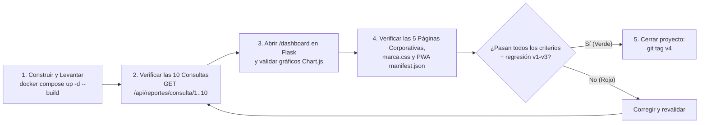

# Guía de Inicio Rápido y Validación — MIRA v0.4 (`7_quickstart.md`)

> **Verificación del Dashboard Analítico, las 10 Consultas Multitabla y las Páginas Corporativas**

---

## 1. Diagrama Obligatorio: Ciclo de Validación de la Versión 4



> **Guía de lectura:** Representa el flujo de comprobación integral de la `v0.4` desde el levantamiento con Docker Compose hasta la verificación de las 10 consultas multitabla, el dashboard con Chart.js y las páginas corporativas.

---

## 2. Comandos de Prueba Rápida (`curl`)

### 2.1. Consultar el Dashboard Consolidado (10 consultas multitabla)
```bash
curl -H "Authorization: Bearer <TOKEN_JWT>" http://localhost:8081/api/reportes/dashboard
```

### 2.2. Consultar individualmente cualquiera de las 10 consultas multitabla (`1` a `10`)
```bash
curl -H "Authorization: Bearer <TOKEN_JWT>" http://localhost:8081/api/reportes/consulta/1
curl -H "Authorization: Bearer <TOKEN_JWT>" http://localhost:8081/api/reportes/consulta/7
curl -H "Authorization: Bearer <TOKEN_JWT>" http://localhost:8081/api/reportes/consulta/10
```

### 2.3. Rutas Web en el Frontend (`http://localhost:5000`)
- **Dashboard Analítico:** `http://localhost:5000/dashboard`
- **Páginas Corporativas:**
  - `http://localhost:5000/corporativo/inicio`
  - `http://localhost:5000/corporativo/servicios`
  - `http://localhost:5000/corporativo/nosotros`
  - `http://localhost:5000/corporativo/soporte`
  - `http://localhost:5000/corporativo/contacto`
