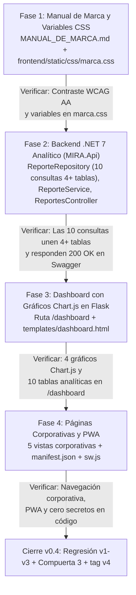

# Plan de Tareas y Orden de Fases — MIRA v0.4 (`8_tasks.md`)

> **Desglose de Tareas de Construcción y Cierre de la Versión 4**

---

## 1. Diagrama Obligatorio: Orden de Fases con Compuertas

> **Guía de lectura:** Muestra la secuencia ordenada de las cuatro fases de la `v0.4` y la condición de verificación en cada flecha antes de declarar cerrado el proyecto con `tag v4`.

---

## 2. Lista de Tareas Completadas (v0.4)

- [x] **T1.1:** Redactar `MANUAL_DE_MARCA.md` definiendo logosímbolo, paleta hexadecimal con contraste WCAG AA, tipografías, tamaño mínimo, área de reserva y usos incorrectos.
- [x] **T1.2:** Centralizar todas las variables de identidad visual en `frontend/static/css/marca.css`.
- [x] **T2.1:** Crear los modelos analíticos en `MIRA.Api/Modelos/ReporteMultitabla.cs`.
- [x] **T2.2:** Implementar `IReporteRepository` y `ReporteRepository` con las **10 consultas SQL multitabla (de 4 a 7 tablas cada una)** usando Dapper.
- [x] **T2.3:** Implementar `IReporteService`, `ReporteService` y `ReportesController` (`/api/reportes/dashboard` y `/api/reportes/consulta/{numero}`) y registrarlos en `Program.cs`.
- [x] **T3.1:** Implementar la ruta `/dashboard` en `frontend/app.py` y la vista `frontend/templates/dashboard.html` con gráficos interactivos en Chart.js y explorador de las 10 consultas.
- [x] **T4.1:** Crear las 5 páginas corporativas (`inicio`, `servicios`, `nosotros`, `soporte`, `contacto`) y el soporte PWA (`manifest.json` y `sw.js`).
