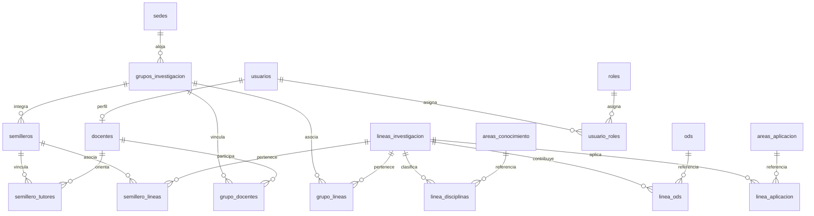

# Modelo de datos MIRA V2

Fuente confirmada por el usuario: [SQL originales y blobs](../../docs/fuentes/sql/README.md). La migración 006 conserva las 19 tablas del archivo completo; `v2_modelo_oficial.sql` reconstruye esa fuente en un esquema aislado y compara columnas, orden, tipo, longitudes, nulabilidad, PK/FK, UNIQUE/CHECK e índices contra las tablas implementadas. No se añaden columnas.

## Entidades y relaciones

`palabras_clave` es el catálogo independiente restante. Todas las PK simples son integer/serial; cinco puentes y `usuario_roles` tienen PK compuesta. Ninguna FK es nullable. Campos opcionales incluyen CvLAC, escalafón, categoría, descripción, fecha_fin y deleted_at según cada tabla; consultar el SQL para la definición exacta.

La ficha implementada usa grupo→semilleros. Los semilleros omitidos se retiran lógicamente. Docentes y semillero_tutores no tienen indicador de estado; el retiro físico conserva las acciones CASCADE del modelo. `grupo_docentes` sí tiene activo. Las seis tablas singulares V1 y `usuario`/`rol`/`usuario_rol` de 003 siguen intactas, además del modelo plural.

Migraciones: 001 tablas V1; 002 semillas V1; 003 rutinas legadas; 004 funciones V1; 005 trigger de área; 006 modelo confirmado; 007 vistas y 78 funciones académicas. Los scripts aplican cada migración pendiente una sola vez mediante `schema_migrations`. No ejecutar directamente las copias fuente contra una base existente.
